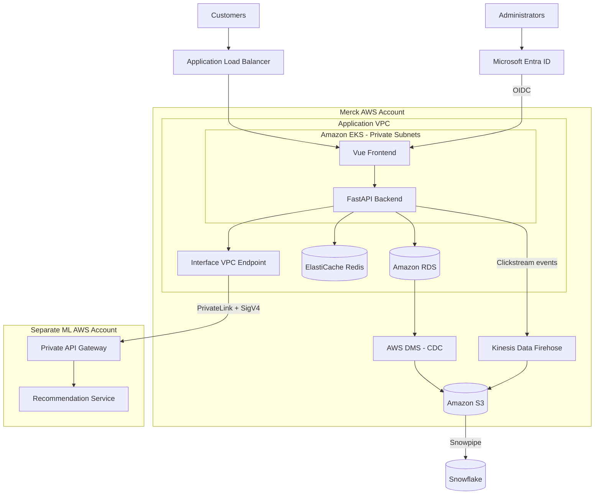

Architecture & Design

## 1. Overall Architecture

The solution uses a containerized Vue frontend and FastAPI backend both deployed on Amazon EKS.

- **Frontend:** Vue application served through Nginx.
- **Backend:** FastAPI handles products, carts, checkout, and recommendation requests.
- **Networking:** An internet-facing Application Load Balancer routes traffic to the frontend. The backend is accessible only through an internal Kubernetes Service.
- **Data:** Amazon RDS stores transactional data, while Redis provides low-latency caching.
- **Infrastructure:** Terraform provisions the VPC, EKS cluster, IAM resources, cluster add-ons, and application workloads.
- **Scaling:** Kubernetes HPA scales application pods based on resource utilization.

## 2. Fast Personalized Recommendations

Snowflake is an analytical data warehouse and should not be queried synchronously during customer requests.

Instead, the backend retrieves recommendations from a dedicated recommendation API. Frequently requested or personalized results are cached in Redis, reducing repeated calls to the ML service.

The recommendation service uses precomputed customer features and model outputs, periodically refreshed through asynchronous data pipelines.

If the recommendation service becomes unavailable, the backend can serve cached recommendations or fall back to popular products.

This approach keeps recommendation latency low and prevents analytical workloads from affecting transactional performance.

## 3. RDS and Clickstream Data Flow to Snowflake

**Transactional data: RDS → Snowflake**

- Amazon RDS remains the source of truth for transactional data.
- AWS Database Migration Service (DMS) performs an initial full load and captures subsequent changes using Change Data Capture (CDC).
- DMS delivers changes to Amazon S3.
- Snowflake ingests the staged data using Snowpipe.
- Data transformations produce analytics-ready datasets.

**Clickstream: Application → Snowflake**

- Frontend and backend services generate events such as product views, searches, cart additions, and purchases.
- Events are delivered asynchronously through Amazon Kinesis Data Firehose.
- Firehose buffers and delivers events to Amazon S3.
- Snowpipe ingests new data into Snowflake for analytics.

**Trade-offs:** This architecture decouples analytics from transactional workloads and provides durable, scalable ingestion. The trade-off is eventual consistency: data is not necessarily available in Snowflake immediately. That is acceptable for analytical use cases.

## 4. Secure ML API Integration

The recommendation API is exposed through a private Amazon API Gateway in a separate AWS account.

The application VPC uses an interface VPC endpoint to connect to the private API through AWS PrivateLink.

- The backend receives a dedicated IAM identity through EKS Pod Identity or IRSA.
- Requests use HTTPS and AWS Signature Version 4 (SigV4) authentication.
- API Gateway resource policies restrict access to authorized VPC endpoints and IAM principals.
- The API is not exposed through a public endpoint.

This provides secure cross-account service communication without exposing the recommendation service to the internet.

## 5. Microsoft Entra ID SSO

Microsoft Entra ID is the identity provider for the administrative control panel, using Merck's existing Entra tenant.

- Integrate the application using OpenID Connect (OIDC).
- Use Authorization Code Flow with PKCE.
- The backend validates access tokens, including their signature, issuer, audience, and expiration.
- Entra ID group claims are mapped to application roles.
- Backend role-based access control protects administrative operations.

This provides centralized authentication and authorization without introducing a separate identity management system.
